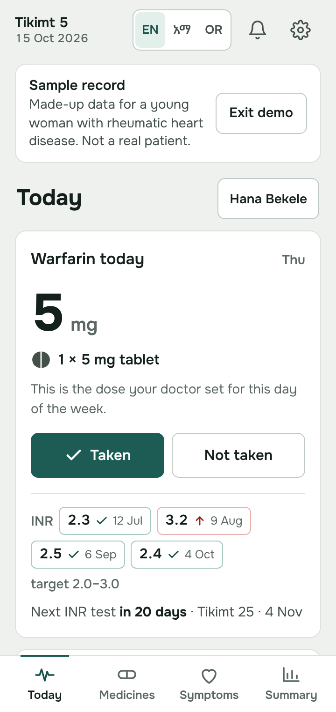
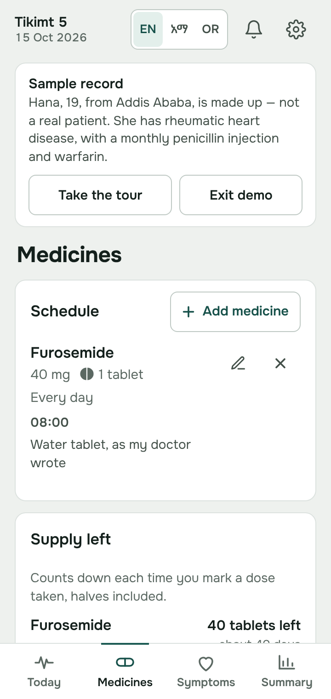
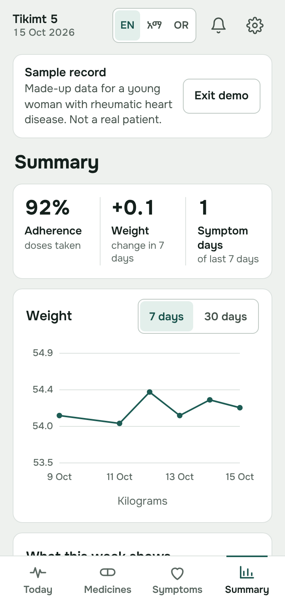
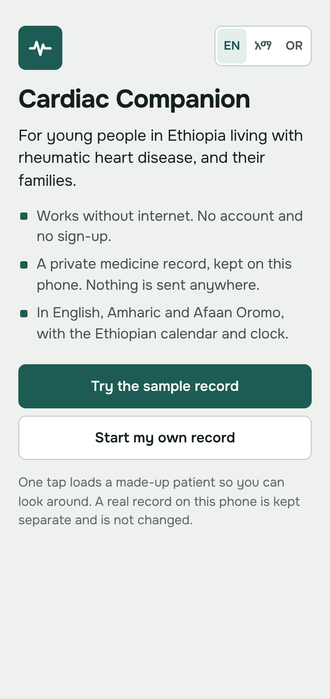
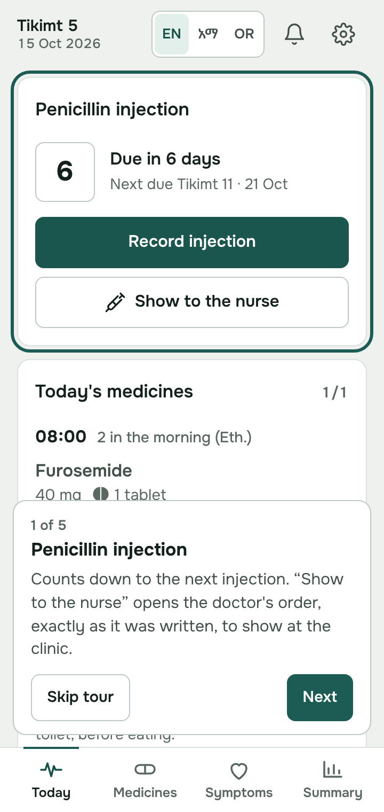
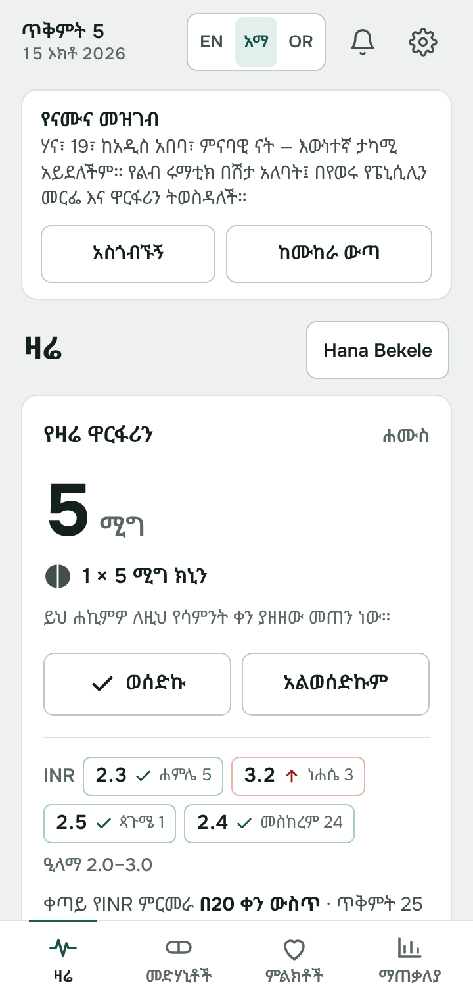
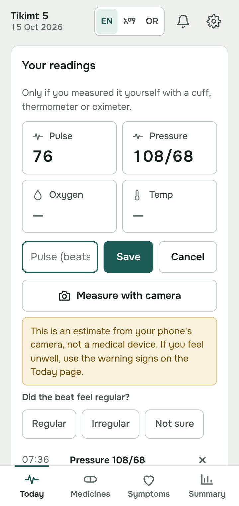

# Cardiac Companion

A medicine record for people with heart disease in Ethiopia, and for the
parents who keep a child's record. It runs on Android phones with no
internet and no account. Everything stays on the phone.

It is built mainly for rheumatic heart disease, where two treatments matter
most and are hardest to keep on a paper card: warfarin, with regular INR
blood tests, and the benzathine penicillin injection every few weeks.

**Try it:** https://cardiac-companion.vercel.app. Tap "Try the sample
record" to look around with a made-up patient. A five-stop guided tour
starts on its own (skip it any time). The first screen and the sample come
in English, Amharic and Afaan Oromo. The demo runs in the browser and keeps
anything you type in that browser only.

Version 4.0 (Android app in progress). The web demo is built from the same
code, on every push to `main` (see `docs/demo-build.md`).

> **Not a medical device.** Cardiac Companion is a personal record and reminder
> tool. It does not diagnose, treat or give medical advice. It never computes,
> suggests or changes a dose: it only shows what the person entered from their
> doctor's instructions. Always follow your doctor or nurse. If you feel unwell,
> use the warning signs in the app and get help.

## What it does

- Shows today's warfarin dose as the doctor wrote it, with the tablets to
  take, and keeps INR results against the doctor's target range.
- Counts down to the next penicillin injection (every 2 to 4 weeks, as the
  clinic orders) and keeps a record of each one. There is a screen to show
  the nurse.
- Lists today's medicines by time, counts tablets left and warns before
  they run out.
- Keeps daily weight, readings the person measured themselves, symptoms, a
  short mood check and notes.
- Lists the warning signs, and makes calling the clinic, the ambulance or
  family one tap.
- Makes a visit summary for the doctor (a PDF in English, with an optional
  copy in the person's own language) and a shorter update for family.
- Can estimate the pulse rate with the phone camera and a fingertip, on the
  web demo and on Android. This is a wellness estimate only. It is not
  validated for medical use and is not a diagnosis, and the "not a medical
  device" line is shown right under the button (see
  `docs/android/DECISIONS.md` and `docs/NEEDS-CLINICAL-REVIEW.md`).
- Works in English, Amharic and Afaan Oromo, with Ethiopian and Gregorian
  dates and the Ethiopian clock.
- Keeps several people on one phone, with an encrypted one-file backup and
  an optional PIN lock (see Privacy below).
- Has a made-up sample record and a short guided tour, for showing the app.

## What it does not do

- It never works out, rounds or changes a dose. It shows what was entered.
- It does not diagnose. It compares an INR result with the range the doctor
  set, and shows fixed warning-sign text. Nothing else is interpreted.
- It sends nothing anywhere. There are no servers, accounts, analytics, ads
  or crash reports, and no fonts or code from the internet.

## Screenshots

From the web demo with the sample record (made-up data, not a real patient).

| Today | Medicines | Summary |
|---|---|---|
|  |  |  |

| First screen | Guided tour | Amharic | Camera pulse, with its disclaimer |
|---|---|---|---|
|  |  |  |  |

The screenshots were taken before the human polish pass, so the colours,
spacing and the header language control look a little different now.

## Privacy

- **No account, no cloud, no servers.** Everything is stored on the phone
  only. The Android app has no internet permission, no analytics, no ads, no
  crash reporting and no remote code or fonts. Its only permission is the
  camera, asked for when you tap "Measure with camera". Camera frames are
  never saved or sent. Android's automatic cloud backup is switched off.
- **Data leaves the phone only when you choose to share a file**, such as a
  backup, a PDF summary, a CSV export or a calendar file.
- **Backups are encrypted.** "Back up now" asks for a passphrase and encrypts
  the file on the phone (Web Crypto: PBKDF2 with SHA-256 and 310,000 rounds,
  a random salt, then AES-256-GCM with a random IV). Without the passphrase,
  nobody can open the file, and nobody can recover a forgotten passphrase.
  Older unencrypted backups can still be restored, with a warning.
- **Optional PIN lock**, off by default (Settings, then PIN lock). The PIN is
  4 to 6 digits and only a salted PBKDF2 hash of it is stored. The app asks
  for it when it opens and each time it comes back to the screen. After 5
  wrong tries it waits 30 seconds. There is no account, so a forgotten PIN
  cannot be reset: the only way back in is to clear all data, then restore a
  backup. The PIN keeps other people out of the app on a shared phone. It
  does not encrypt the data stored inside the app.

## Run it

You need [Node.js](https://nodejs.org/) 22 or later.

```
npm install
npm test
```

In a browser, for development: the app is plain HTML and JavaScript in
`www/`, with no build step. Serve the folder and open it:

```
python3 -m http.server 8080 --directory www
```

Then open http://localhost:8080. Use `localhost` (or another secure
address), because encrypted backups and the PIN lock need the browser's Web
Crypto. `npm run build:web` and `npm run preview:web` build and open the
same static demo that the website uses.

As the Android app, you also need JDK 21 and the Android SDK (Android Studio
is the easiest way to get both). The app targets Android 16 (API 36) and
runs on Android 7.0 (API 24) and later.

```
npx cap sync android
npx cap open android
```

Or build a debug APK from the command line:

```
cd android
gradlew.bat assembleDebug      (./gradlew on macOS or Linux)
```

The APK is in `android/app/build/outputs/apk/debug/`. GitHub Actions also
builds one on every push (`.github/workflows/android.yml`). Release signing
is set up by the project owner and is not in this repo.

## Tests

```
npm test
```

This runs every test file in `tests/`. The medical rules run three times, in
the Addis Ababa, UTC and New York time zones, because dates must follow the
phone's own calendar day. The tests also check that all three languages have
every string, that the design rules hold, and that the Android app loads
nothing from the internet.

## Where things are

| Path | What it is |
|---|---|
| `www/index.html` | The screens, and the code that draws them |
| `www/css/app.css` | The styles. See `docs/DESIGN-DECISIONS.md` |
| `www/js/strings.js` | Every word the app shows, in three languages |
| `www/js/core/` | The medical rules, small files tested in Node |
| `www/js/platform/` | The only code that talks to Android |
| `www/js/secure.js` | Encrypted backups and the PIN hash |
| `www/js/demo.js` | The made-up sample record |
| `www/ppg-engine.js` | The camera pulse estimate |
| `www/pulse-quality.js` | Rates each camera reading good or poor |
| `android/` | The Capacitor Android project |
| `tests/` | `npm test` |
| `tools/` | The web demo build, the pulse lab and other developer tools. Not shipped |
| `docs/` | Decisions, found bugs, wording waiting for review, screenshots |
| `docs/PROJECT-RULES.md` | The safety charter and working rules for the project |

## Rules for changes

The safety rules are in `docs/PROJECT-RULES.md`. The short version:

- Health wording is frozen in all three languages. Propose changes in
  `docs/NEEDS-CLINICAL-REVIEW.md`.
- Amharic and Afaan Oromo are only changed by a native speaker.
- A suspected bug in the medical logic is written up in
  `docs/android/FOUND-BUGS.md`, not fixed quietly.
- Storage changes need a tested migration that loses nothing.
- Run `npm test` before every commit.

## Known limits

- Reminders only ring while the app is open or was used recently. For
  alarms that ring when it is closed, the app can add the times to the
  phone's calendar. Android's own notifications come in a later phase.
- Saving and sharing files (backup, PDF, CSV) inside the Android app comes
  in a later phase. In a browser they work now.
- The camera pulse has not been checked against a pulse oximeter on real
  phones yet. `docs/pulse-accuracy-check.md` says how.
- The Amharic and Oromo strings added in version 3 and later still need a
  review by a native speaker.
- Open questions for the clinical lead are in `docs/NEEDS-CLINICAL-REVIEW.md`
  and `docs/android/FOUND-BUGS.md`.

## License

Licensed under the [Apache License 2.0](LICENSE). Copyright 2026 Amin
Mohammed. The bundled fonts (Onest and Noto Sans Ethiopic) are under the SIL
Open Font License; their licences are in `www/fonts/`.

